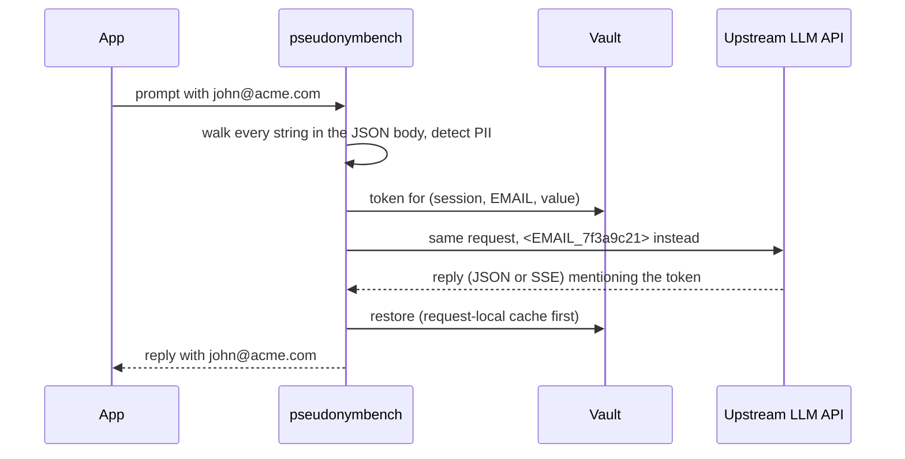

# pseudonymbench

Mask PII before a prompt reaches an LLM API, put it back in the reply, and measure what that costs and what it misses.

pseudonymbench is a small reverse proxy for OpenAI-style chat-completions APIs, plus the benchmark harness used to test it. The proxy replaces emails, phone numbers, SSNs, card numbers and IBANs with random tokens such as `<EMAIL_7f3a9c21>`, keeps the real values in a vault, and restores them in the response, including when a token arrives split across streamed chunks. The harness measures what other tools in this space rarely publish: added latency and time-to-first-token at a fixed arrival rate, per-entity precision and recall, and which request fields leak.

> **Status: research-grade.** Numbers below are from synthetic and public datasets and from one laptop. This is pseudonymization, not anonymization, and it makes no compliance claim. Read [what it misses](#what-it-misses) before trusting it with anything real.

## Results

All of these are reproducible from this repo; commands are under [Reproduce](#reproduce). Method and caveats: [docs/benchmarking.md](docs/benchmarking.md).

### What the proxy costs

Added latency against going straight to the upstream, at 100 requests/s open-loop, 3,000 requests per cell (30 s after a 4 s warmup). The mock upstream waits 150 ms (prefill), then streams a 960-byte reply as 240 chunks 12 ms apart, so a completion takes about 3 s. Apple M4, 16 GB, macOS, Go 1.26.3; generator, proxy and mock share the machine and no run used Docker, so treat this as a laptop result, not a benchmark of record. In-memory vault; the Redis row has not been run.

<!-- overhead:start -->
| payload | JSON: added p50 (ms) | JSON: added p99 (ms) | stream: added TTFT p50 (ms) | stream: added TTFT p99 (ms) | baseline TTFT p50 / p99 (ms) | noise floor: JSON p50 / p99, TTFT p50 / p99 (ms) |
|---|---:|---:|---:|---:|---:|---|
| pii | +0.5 | +0.6 | +0.5 | -2.5 | 151.1 / 158.5 | 0.2 / 0.1, 0.0 / 4.4 |
| pii-long | +0.7 | +0.9 | +0.6 | +1.5 | 151.2 / 154.3 | 0.1 / 0.2, 0.1 / 0.2 |
| plain | +1.4 | +6.9 | +0.4 | +0.7 | 151.2 / 155.2 | 1.1 / 1.9, 0.0 / 0.1 |
| tools | +0.4 | +0.6 | +0.4 | +1.2 | 151.2 / 154.6 | 0.1 / 0.0, 0.0 / 0.0 |

What this says:

- **The proxy adds about half a millisecond at the median** for payloads that contain PII, both to a complete JSON response and to the time until the first streamed token (baseline first token: 151 ms). At p99 the added time is about 1 ms for those payloads, close to what this machine can resolve: two identical baseline runs differ by up to 4.4 ms at p99 for time to first token (right-hand column), so read p99 as "a millisecond or two", not as a precise number.
- **The `plain` row is worse than the PII rows, which is backwards.** Its median gap (+1.4 ms) is inside the noise of that cell pair (the repeat baseline was 1.1 ms slower than the first). Its p99 gap (+6.9 ms) is larger than that pair's noise floor (1.9 ms), and I have not found a cause: the same cell showed +0.9 ms and +0.8 ms in two earlier full runs, so it looks like a one-off tail event on a shared laptop, but a quiet host and more samples are needed to say.
- **Streams are compared on time to first token only.** The total duration of a 240-chunk stream varies by up to 25 ms between two identical baseline runs on this machine (timer jitter accumulates over 240 sleeps), which is larger than any effect being measured. The full table with those columns is in [`results/laptop-3/REPORT.md`](results/laptop-3/REPORT.md).
- Detection itself is cheap: `go test -bench` measures about 1.4 µs for 2 KB of prose and about 22 µs for 1.8 KB containing 40 PII values. The rest of the half millisecond (the extra network hop, JSON decode and encode, the vault) is not broken down here.

Run it with `scripts/bench.sh`; `go run ./cmd/benchreport -subject pseudonymbench results/<run>/*.json` prints this table.
<!-- overhead:end -->

### What it catches

Per-entity scores for the regex tier, measured through the proxy (send text, read what the upstream received). Recall by span overlap; "bytes left visible" is the share of PII bytes that no mask covered.

**Public data: [`nvidia/Nemotron-PII`](https://huggingface.co/datasets/nvidia/Nemotron-PII) test split, first 3,000 rows (CC-BY-4.0, synthetic text)**

| kind | gold spans | recall | bytes left visible | precision | F2 |
|---|---:|---:|---:|---:|---:|
| EMAIL | 1,221 | 0.998 | 0.1% | 1.000 | 0.998 |
| PHONE | 638 | 0.997 | 0.3% | 0.985 | 0.994 |
| SSN | 249 | 1.000 | 0.0% | 1.000 | 1.000 |
| CARD | 380 | 0.113 | 88.8% | 1.000 | 0.138 |
| IBAN | 0 | n/a | n/a | n/a | n/a |

The card row is not a detector failure in the usual sense. Only 41 of the 380 card numbers in this dataset pass the Luhn check (10.8%); the text generator invented the rest, and a real card number always passes. The detector produced 41 card matches: exactly the valid ones. Dropping the check would raise recall on this data and mask many more order IDs on real data. Another 23,038 gold spans (names, addresses, dates, account numbers, ...) are outside what a regex tier targets and are not scored. The dataset has no IBAN labels.

**Synthetic set: 2,000 seeded samples with look-alike negatives** (values follow the same public rules the detectors check, so recall here is a self-check; the point is the precision column)

| kind | gold spans | recall | precision | F2 |
|---|---:|---:|---:|---:|
| EMAIL | 637 | 1.000 | 1.000 | 1.000 |
| PHONE | 551 | 1.000 | 0.866 | 0.970 |
| SSN | 568 | 1.000 | 1.000 | 1.000 |
| CARD | 614 | 1.000 | 0.978 | 0.995 |
| IBAN | 606 | 1.000 | 1.000 | 1.000 |

6.8% of PII-free samples had something masked. Almost all of that is 10-digit IDs that look like US phone numbers and 16-digit IDs that happen to pass Luhn: a checksum alone lets about one random digit string in ten through.

Not run yet: a Presidio analyzer row (`eval presidio`, needs Docker) and rival proxies.

### Which request fields leak

A distinct canary email is planted in each of 21 request fields and the body the upstream received is checked. The control sends the same requests straight to the mock.

| request field | pseudonymbench | no proxy (control) |
|---|---|---|
| `messages[].content` (string) | masked | LEAKED |
| `messages[].content[].text` | masked | LEAKED |
| system message | masked | LEAKED |
| developer message | masked | LEAKED |
| assistant message | masked | LEAKED |
| assistant refusal | masked | LEAKED |
| `tool_calls[].function.arguments` (value) | masked | LEAKED |
| `tool_calls[].function.arguments` (key) | masked | LEAKED |
| tool message content | masked | LEAKED |
| `tools[].function.description` | masked | LEAKED |
| `tools[].function.parameters` (schema text) | masked | LEAKED |
| `functions[].description` (legacy) | masked | LEAKED |
| `user` | masked | LEAKED |
| `metadata` (value) | masked | LEAKED |
| `metadata` (key) | masked | LEAKED |
| `stop` | masked | LEAKED |
| `prediction.content` | masked | LEAKED |
| `response_format.json_schema.description` | masked | LEAKED |
| `image_url.url` (http, query string) | masked | LEAKED |
| unknown top-level field | masked | LEAKED |
| unknown top-level field (its name) | masked | LEAKED |

The same command can fill in a column for any other proxy that can be pointed at the mock: `scripts/eval.sh` with `RIVALS=...`.

## Quick start

```bash
# 1. a stand-in LLM API that echoes what it receives
go run ./cmd/mockupstream -listen :9000 -first-token 100ms -token-delay 20ms &

# 2. the proxy in front of it (in-memory vault)
go run ./cmd/pseudonymbench -listen :8080 -upstream http://localhost:9000 &

# 3. send a prompt
curl -s localhost:8080/v1/chat/completions -H 'Content-Type: application/json' \
  -d '{"model":"m","messages":[{"role":"user","content":"Email john@acme.com about card 4111 1111 1111 1111"}]}'
```

The reply contains the original values; the mock (and in real use, the provider) only ever saw `<EMAIL_...>` and `<CARD_...>`. Add `"stream": true` to see the streaming path. To use a real API, set `-upstream https://api.openai.com`; clients keep sending their own `Authorization` header.

With Docker: `export PSEUDONYMBENCH_KEY=$(openssl rand -hex 32) && docker compose up --build` starts the proxy with a Redis vault and the mock.

Useful flags: `-policy CARD=block,PHONE=off` (per-kind `mask`, `block` or `off`), `-vault redis -redis-url ...`, `-ttl 15m`, `-audit file|-|off`. Send an `X-Pseudonym-Session` header to keep the same value on the same token across a conversation. `pseudonymbench -h` lists everything.

## How it works



- **Detection** is regex plus validation, no ML: Luhn and an issuer table for cards, mod-97 and per-country length for IBANs, SSA structure rules for SSNs, NANP and E.164 shapes for phones. Details and the overlap rule: [docs/design.md](docs/design.md).
- **Masking is default-scan.** Every string in the request is scanned except a short list of fields the API validates (`model`, `role`, function names, base64 data). Unknown fields are scanned, not skipped. Tool-call `arguments` (JSON inside a string) are parsed and scanned.
- **The stream rewriter** holds back only a trailing piece of text that could still grow into a token (at most 15 bytes), per choice and per field, and flushes it on the finish chunk, `[DONE]`, an error frame or end of input. Ordinary prose passes through in the event it arrived in. It is tested at every split position, with random chunking, with `n>1`, with parallel tool calls, and by a fuzz target that compares chunked output to whole-text restoration.
- **Fails closed.** Invalid JSON, a compressed body, an oversize body, an unknown path, a blocked kind or a vault error returns an error; nothing is forwarded.
- **Vault.** In memory or Redis. Redis holds AES-256-GCM ciphertext (bound to session and token) and HMAC-keyed value hashes, never plaintext, and allocation needs no Lua script.
- **Audit log.** One JSON line per request: kinds, counts, timings, outcome. Never values, prompts or headers (a test greps for them).

## What it misses

The full table with evidence is in [docs/threat-model.md](docs/threat-model.md). The ones that matter most:

| Miss | Notes |
|---|---|
| Names, addresses, dates of birth, free-text identifiers | No NER. 23,038 of the roughly 25,500 labelled spans in the Nemotron sample are of this kind. |
| Card numbers that fail Luhn | By design; see the card row above. |
| Look-alikes | 10-digit IDs starting 2-9 and Luhn-passing 16-digit IDs get masked. Reversible, but they cost the model context. |
| Tokens the model changes | Restoration is exact-match. A lowercased, spaced, truncated or paraphrased token stays as the model wrote it; it is never restored to a wrong value (tested). |
| Tokens in links | Tokens inside a URL are deliberately left unrestored so a prompt-injected model cannot smuggle a value into a link. Best effort: links without a scheme and non-URL channels are not covered. |
| The client's query string | Not forwarded (the upstream URL's own query string is). It is a request field the masker never sees. |
| Images, audio, files; other APIs | Only text in chat-completions. Anthropic Messages, the Responses API and other dialects return 403. |
| Quasi-identifiers | ZIP + gender + birth date identify most Americans without any masked field. Out of scope. |
| Size and timing side channels | Not padded. |

## Reproduce

```bash
go test -race ./...                 # unit, integration and property tests
make fuzz                           # 10 s on each fuzz target (FUZZTIME=2m for longer)

scripts/bench.sh                    # overhead matrix -> results/<run>/REPORT.md
scripts/eval.sh                     # detection quality + field matrix on synthetic data
go run ./cmd/dataprep nemotron -n 3000 && DATA=data/nemotron-pii.jsonl scripts/eval.sh
```

Requirements: Go 1.26, `curl`, `openssl`. Redis rows and rivals need Docker; see [docs/benchmarking.md](docs/benchmarking.md) and `bench/rivals/litellm/` (an untested template).

## Repository layout

```
cmd/pseudonymbench   the proxy
cmd/mockupstream     fake LLM API with fixed timing; records what it receives
cmd/loadgen          open-loop load generator (latency, time to first token)
cmd/benchreport      results -> Markdown table of deltas against a baseline
cmd/eval, dataprep   detection scoring, field matrix, public dataset converter
internal/detect      PII detectors        internal/token   token format, stream hold-back rule
internal/mask        request masking, response restoration, URL guard
internal/stream      SSE rewriter         internal/vault   memory + Redis vaults, AES-GCM
internal/proxy       HTTP handler, audit  internal/eval    scoring, field matrix, diffing
docs/                design, threat model, benchmarking method, spec, research notes
```

## Related work

Several open-source proxies already mask and restore PII for OpenAI-style APIs. As of 2026-10-19, from reading their READMEs and source (see [docs/research](docs/research/)), none of those I read published all of: open-loop overhead against a direct baseline, a time-to-first-token delta, per-entity precision and recall on a redistributable dataset, and a field-coverage matrix. That is a statement about what I found, not a proof.

| Project | What I found |
|---|---|
| [PrivAiTe](https://github.com/crp4222/PrivAiTe) | Streaming restore, a published scanned/not-scanned field list for two APIs, an agent-workflow latency benchmark; no TTFT; its main accuracy corpus is not redistributable |
| [LLM-Shield-Proxy](https://github.com/ninadphalak/LLM-Shield-Proxy) | Sliding-window SSE restore; timings are in-process microseconds and say they are not end-to-end |
| [Tamga](https://github.com/yatuk/tamga) | Go gateway; k6 open-loop load results, but with a no-PII payload and no direct baseline |
| [PasteGuard](https://github.com/sgasser/pasteguard) | Mask and restore with streaming; ships an accuracy harness, no committed results |
| [Anwesha33/pii-shield](https://github.com/Anwesha33/pii-shield) | A Go proxy with a plan close to this one's. At the commit I read it held back text for `content` only, shared one buffer across choices, and published detector latency, not proxy overhead |
| [LiteLLM Presidio guardrail](https://docs.litellm.ai/docs/proxy/guardrails/pii_masking_v2) | Masks and restores; for OpenAI-format streams the guardrail buffers the whole response (see the research notes), which makes first-token latency equal full generation time |
| [LLM Guard](https://github.com/protectai/llm-guard) | Anonymize/deanonymize scanners as a library; archived 2026-07 |

A different project named `maskgate` (`tsymbaluyk/maskgate`) exists; this repository is unrelated to it, which is why it is called pseudonymbench.

## Limits and wording

- It is a benchmarked research tool, not production-grade software, and nothing here is a statement about legal compliance.
- The proxy is a fully trusted component: it sees every prompt in plaintext and the `Authorization` header. Run it inside your trust boundary behind TLS.
- Overhead numbers are from one laptop. The Redis, LiteLLM and Presidio rows have not been run (no Docker daemon was available while writing this); the code and templates exist.
- Dataset: Nemotron-PII is by NVIDIA, licensed CC-BY-4.0; it is fetched on demand and not stored in this repository.
- No licence file has been chosen yet.
