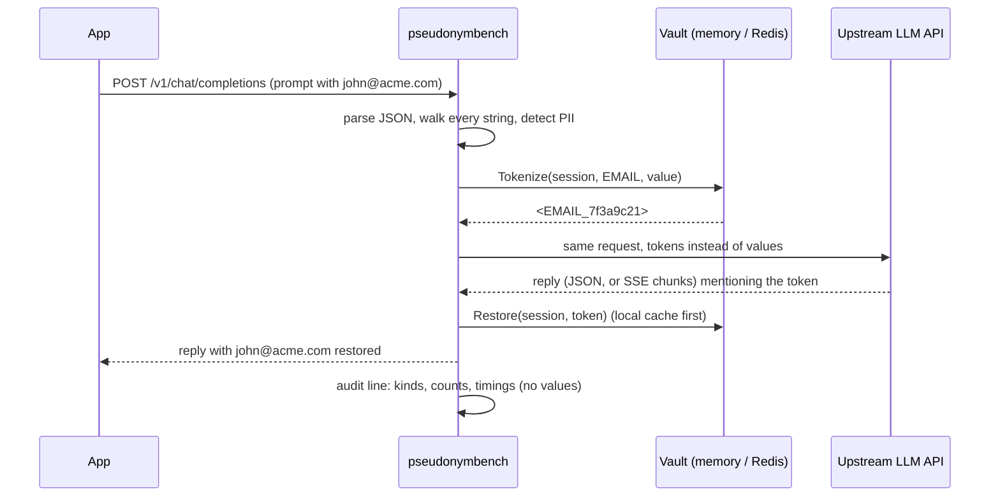

# Design

## Request flow



Anything the proxy cannot scan is rejected before the upstream sees it: invalid
JSON, a non-object body, a compressed body, an oversize body, a path other than
`POST /v1/chat/completions` (plus `GET /v1/models` and `/healthz`), or a vault
failure.

## Packages

| Package | Job | I/O? |
|---|---|---|
| `internal/detect` | Find PII spans: regex candidates, then checksum or structure validation (Luhn + issuer table, mod-97, SSA rules, NANP/E.164) | none |
| `internal/token` | The `<KIND_xxxxxxxx>` format, `SplitTail` (what to hold back when a stream chunk ends mid-token) | none |
| `internal/vault` | Token to value mapping per session. Memory and Redis backends, AES-256-GCM sealing, HMAC value index | Redis |
| `internal/mask` | Walk a request body and replace PII with tokens; restore tokens in a response; the URL guard | vault |
| `internal/stream` | SSE rewriter: restores tokens in a stream without waiting for the end | none (wraps a reader) |
| `internal/proxy` | HTTP handler: routing, fail-closed checks, session ids, relay, audit log | network |
| `internal/eval`, `internal/synth`, `internal/bench` | Measurement: synthetic data, scoring, field matrix, result files | test only |

The detectors, token grammar and stream rewriter do no I/O. That is deliberate:
they are the parts with subtle invariants, and they can be fuzzed without a
network.

## Detection

Go's `regexp` is RE2: linear time, no lookaround. Each detector therefore finds
a candidate with a regex, then checks boundaries and validity in code.

| Kind | Candidate | Validation |
|---|---|---|
| Email | ASCII local part, dotted domain, alphabetic TLD | length limits, no `..`, no trailing dot in the local part |
| Card | runs of digit groups joined by one space or hyphen | whole-group windows of 13-19 digits, one separator style, Luhn, issuer prefix and length table |
| IBAN | two letters, two digits, then up to 30 alphanumerics | span cut to the country's length, mod-97, no alphanumeric glued to the end |
| SSN | `AAA-GG-SSSS` (hyphens or spaces, not mixed), or nine digits after "SSN" / "social security" | not area 000/666/9xx, group 00, serial 0000 |
| Phone | `+` international, or NANP with optional `1` | 10 digits (11 with leading 1) with area and exchange starting 2-9; `+` numbers 8-15 digits, `+1` always 11 |

When two kinds overlap, the earlier one in `detect.Kinds` wins: IBAN, card,
email, SSN, phone. That order is "most specific first": a random string passes
mod-97 about 1 time in 97, Luhn about 1 in 10, and phone has the loosest shape.
It was chosen after a generated numeric IBAN turned out to contain a Luhn-valid
window that the card detector claimed.

Candidate windows are bounded, so adversarial input cannot make a detector
quadratic: a card run is at most 19 digits per start group, and a rejected phone
candidate retries from the next byte.

## Token format

`<KIND_xxxxxxxx>`: the kind, an underscore, 8 lowercase hex digits (32 random
bits from `crypto/rand`), in angle brackets. Reasons:

- Typed and unmistakable, so models tend to copy it as one unit.
- Random, not derived from the value, so a token reveals nothing. Within a
  session the same `(kind, value)` always gets the same token (a value index
  keyed with HMAC), so a model sees a consistent name across turns.
- Eight hex digits keep collisions rare (the vault still checks and retries).
- Longest token is 16 bytes, which bounds the stream hold-back.

`<`/`>` can be HTML-escaped by some JSON encoders. The proxy's own encoder does
not escape them, and tests assert that. A model that emits `<` inside
streamed tool arguments is a documented miss (see the threat model).

## Request masking

The body is decoded with numbers kept as text (`json.Number`), so large integers
and floats pass through byte for byte, and encoded again without HTML escaping.
Key order is not preserved (Go sorts map keys); the JSON is semantically
identical.

The walk is **default-scan**: every string is scanned unless its key is on a short
list of structural fields the API validates (`model`, `role`, `type`, `id`,
`tool_call_id`, `finish_reason`, `name`, `detail`, `format`, base64 `data`
fields, `data:` URLs ...). Unknown top-level keys and `metadata` count as user
data, so their keys are scanned as well as their values. Tool-call `arguments` is
a string containing JSON: it is parsed, every key and string is scanned, and it
is encoded again so escaping stays correct; if it does not parse it is scanned as
plain text. A scanner that skips unknown fields would leak the first time the API
grows one.

## Response restoration

Non-streamed responses are decoded and every string (except structural keys) is
passed through a `Restorer`. Tokens not in the session stay visible and are
counted (`unknown_tokens` in the audit log). Tokens inside a URL stay visible
(`url_skipped`).

### The stream rewriter

A token can arrive in pieces: `...mail <EM`, `AIL_7f3a`, `9c21> now`. The rewriter
keeps one small state per **(choice index, field)**, where field is `content`,
`refusal`, `audio.transcript`, `tool_calls[i].function.arguments` or the legacy
`function_call.arguments`. For each piece of text:

1. Append it to the channel's held text.
2. `token.SplitTail` looks at the last `<` within 15 bytes of the end. If what
   follows is a proper prefix of some token, that tail is held; everything before
   it is safe.
3. The safe part goes through the `Restorer` (token replacement and URL guard).
4. The held tail waits for the next piece.

Ordinary prose has no `<`, so it leaves in the event it arrived in. Text with `<`
(HTML, generics, comparisons) is held only while it could still become a token,
for at most 15 bytes.

Flush rules, each with a test:

| Event | Behaviour |
|---|---|
| A chunk with `finish_reason` for a choice | Held text of that choice is appended to **that chunk's** delta, so it precedes the finish signal |
| `data: [DONE]` | Synthetic chunks carrying any held text are emitted first, copying `id`, `model`, `created` |
| An error frame (`{"error": ...}`) | Held text is flushed, then the error frame is forwarded |
| End of input without `[DONE]` | Held text is flushed, then the stream ends |
| `choices: []` usage chunk | Forwarded untouched |
| Comments, `event:`, `id:` lines, CRLF framing | Preserved |

Events whose text did not change are forwarded **byte for byte**; changed events
are re-serialized. The rewriter parses every event while the URL guard is on,
because the guard has to see every byte of text to know whether a later token sits
inside a link: skipping "plain" events let a `://` split across events go
unnoticed (found by a test, now covered by `TestURLGuardAcrossChunks`).

## Vault

```
{prefix}:{sid}:t2v   token        -> version || nonce || AES-GCM(value), AAD = sid || 0 || token
{prefix}:{sid}:v2t   HMAC(value)  -> token
```

Two hashes share a hash tag (`{sid}`), so they live in one Redis Cluster slot and
expire together. Allocation needs no Lua script:

1. `HGET v2t h` (pipelined with `HLEN v2t` and the TTL refresh): common case, one round trip.
2. Otherwise generate a token and `HSETNX t2v token sealed`. If the token exists, retry.
3. `HSETNX v2t h token`. If another request registered the same value first, adopt
   its token and `HDEL` ours.

The session cap counts `v2t` (distinct values), not `t2v`, because the orphan
tokens that concurrent requests create for a moment must not trip it (found by a
concurrency test).

Keys: one master secret (`PSEUDONYMBENCH_KEY`) is expanded with HMAC-SHA-256 into
three independent keys: sealing, value index, session ids.

The in-memory vault has the same interface and semantics (TTL, cap, isolation)
and keeps values unencrypted in process memory.

## Sessions

- No `X-Pseudonym-Session` header: every request is its own session (random id).
  Tokens for the same value differ between requests.
- With the header: `sid = HMAC(sessionKey, sha256(Authorization) || 0 || header)`.
  Two callers using the same session name, or an attacker who guesses a name,
  land in different vault sessions.
- The header is stripped before the request goes upstream.

## Audit log

One JSON line per request (`log/slog`): request id, path, status, outcome
(`ok`, `blocked`, `invalid_body`, `vault_error`, `upstream_error`, ...), whether it
streamed, a short hash of the session id, masked counts by kind, blocked kinds,
restored counts, unknown/URL-skipped tokens, and timings (mask, upstream headers,
first byte, total). No values, no prompt text, no headers.

## Decisions and rejected options

| Decision | Alternatives | Why |
|---|---|---|
| Go | Java, Python | Small, I/O-bound, concurrent; `net/http` streaming and RE2 fit; native fuzzing. The cost is that Go forces candidate-then-validate regexes, which the detectors need anyway. |
| Regex tier only | Presidio sidecar | A measured regex tier is the baseline; names and addresses need NER, which is its own project (model download, latency, a second service). The eval harness can score a Presidio analyzer later through the same interface. |
| Random tokens + value index | HMAC tokens, format-preserving encryption, fake values | Random tokens leak nothing; deterministic tokens enable offline guessing of low-entropy values if the key leaks; FF3/FF3-1 are dropped from NIST's 2025 draft and fake values can collide with real text. |
| No `hash` policy action | `hash`, `redact` | An unkeyed hash of an SSN or phone is enumerable. Actions are `mask`, `block`, `off`. |
| No Lua | Lua, Redis Functions | `HSETNX` on two hashes is enough for random tokens. Lua would save a round trip and is a good future benchmark axis. |
| Exact-match restoration | Fuzzy matching | Fuzzy restoration can restore a value the model never saw. A changed token stays visible instead. |
| Fail closed | Fail open | Forwarding a body the proxy could not scan defeats the purpose. |
| OpenAI chat-completions only | Anthropic Messages, Responses API | Each is a different SSE dialect and a separate bug class. Other paths return 403 instead of being forwarded unscanned. |
